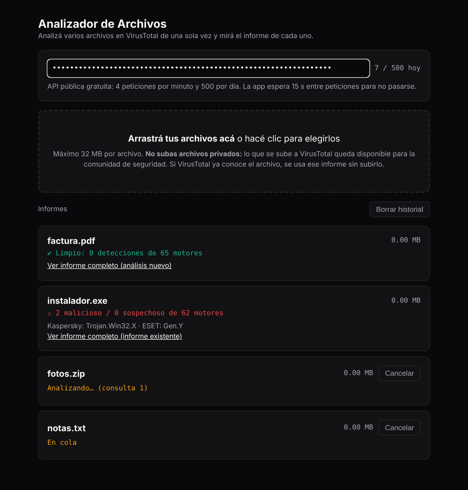

# Analizador de Archivos

Analizá varios archivos en [VirusTotal](https://www.virustotal.com) de una sola vez y mirá el informe de cada uno.



## Qué problema resuelve

En la página de VirusTotal hay que subir los archivos de a uno y esperar cada resultado. Con esta app los arrastrás todos juntos: se ponen en cola, se mandan a VirusTotal respetando sus límites y te muestra el informe de cada uno. Cuando termina, suena un pitido y aparece una notificación, así la podés dejar en segundo plano.

## Qué hace

- **Recibe varios archivos a la vez**, arrastrándolos o eligiéndolos (máximo 32 MB cada uno).
- **Los analiza en cola.** Primero busca la huella SHA-256: si VirusTotal ya conoce el archivo, usa ese informe y no sube nada.
- **Muestra el informe:** cuántos antivirus lo detectan, cuáles y con qué nombre, con un enlace al informe completo.
- **Respeta los límites de la API gratuita:** espera 15 segundos entre peticiones y frena al llegar a 500 por día.
- **Guarda el historial** de informes en el navegador y permite **cancelar** cualquier archivo en curso.

## Cómo usarla en tu PC

**Necesitás:** Python 3 y una API key gratuita de VirusTotal (registrate en virustotal.com, hacé clic en tu perfil y elegí **API key**).

1. Descargá o cloná este repositorio.
2. En la carpeta del proyecto, abrí una terminal y corré:
   ```
   python proxy.py
   ```
3. Abrí **http://localhost:8000** en el navegador.
4. Pegá tu API key y arrastrá tus archivos.

No abras `index.html` con doble clic: el navegador bloquea las llamadas a VirusTotal (CORS) y la app tiene que pasar por `proxy.py`.

## Publicarla en internet

Para usarla desde el celular, el puente hacia VirusTotal se publica gratis en Cloudflare Workers (`worker/worker.js`) y la página en GitHub Pages. El paso a paso está en [docs/PUBLICAR.md](docs/PUBLICAR.md).

## Cómo funciona

```
Navegador (index.html) ──► puente ──► API de VirusTotal
                            │
                            ├─ en tu PC: proxy.py
                            └─ publicada: worker/worker.js (Cloudflare)
```

El navegador no puede hablar directo con VirusTotal porque la API no autoriza llamadas desde otras páginas (CORS). El puente recibe el pedido y lo reenvía. Ninguna de las dos versiones guarda tu API key: la pegás en la página y queda solo en tu navegador.

Por cada archivo, la app hace esto:

1. Calcula el SHA-256 en tu navegador y lo busca en VirusTotal (`GET /files/{hash}`).
2. Si no existe, lo sube (`POST /files`).
3. Consulta el análisis cada 15 segundos hasta que termina (`GET /analyses/{id}`).

## Estructura del repositorio

```
analizador-de-archivos/
├── index.html        La app: interfaz y lógica (HTML, CSS y JS sin librerías)
├── proxy.py          Puente local en Python (solo librería estándar)
├── worker/
│   └── worker.js     Puente en la nube para Cloudflare Workers
└── docs/
    ├── SPEC.md       Spec y registro de decisiones del proyecto
    ├── PROMPTS.md    Prompts usados para construirla con IA, en orden
    ├── PUBLICAR.md   Guía para publicarla
    └── captura.png   Captura de pantalla
```

## Límites conocidos

- La API gratuita de VirusTotal permite 4 peticiones por minuto y 500 por día: un archivo nuevo tarda alrededor de un minuto en analizarse.
- Archivos de hasta 32 MB.
- Si recargás la página con archivos en cola, esos se pierden (los informes terminados quedan guardados).
- **No subas archivos privados:** lo que se sube a VirusTotal queda disponible para la comunidad de seguridad.
- La API pública de VirusTotal es solo para uso no comercial.

## Cómo se hizo

Proyecto del curso de desarrollo de apps con IA de Puerta 18. Se construyó paso a paso con IA: primero la spec, después la base y después una función por vez, probando cada parte antes de seguir. El proceso completo está en [docs/SPEC.md](docs/SPEC.md) (decisiones) y [docs/PROMPTS.md](docs/PROMPTS.md) (prompts).

## Licencia

[MIT](LICENSE)
